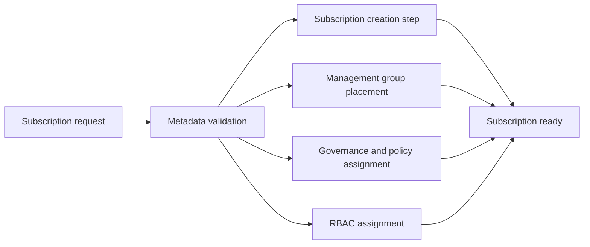

# Azure Subscription Vending

This repository defines a secure, repeatable Azure subscription vending workflow for platform and engineering teams that need controlled provisioning, governance setup, and least-privilege access without committing tenant or billing details to source control.

## What is implemented

This repo contains the Terraform building blocks for:

- A reusable subscription request model with required metadata for business unit, environment, workload, owner, and naming
- Optional Azure subscription creation using a billing scope
- Optional management-group association for subscription placement
- Optional governance assignment through an Azure Policy definition or initiative
- Optional RBAC assignment patterns for least-privilege access
- Example configuration files and CI validation workflow for local safety checks

## Important prerequisites and limitations

This repo is intentionally designed as a governance and workflow model rather than a tenant-specific deployment package.

- Real subscription creation requires valid Azure billing scope permissions and organization-level approval.
- Management group placement and policy assignment require Azure management-plane permissions in the target tenant.
- A production deployment must use an actual billing scope, valid tenant IDs, and a properly secured remote backend.
- This repository does not include any real billing account IDs, tenant IDs, or credentials.

## Repository layout

- `main.tf` builds the end-to-end subscription vending process.
- `variables.tf` defines validated request and governance inputs.
- `modules/` contains the reusable request, subscription, RBAC, management-group, and governance assignment modules.
- `examples/` contains safe placeholder configuration files.
- `docs/architecture.md` explains the architecture and operating model.
- `.github/workflows/terraform-ci.yml` runs formatting, backend-disabled init, validation, and YAML checks.

## Safe usage guidance

- Keep remote state in a secure backend, such as Azure Storage with controlled access.
- Never commit secrets, tenant details, real subscription IDs, state files, or plan files.
- Use the `examples/terraform.tfvars.example` file as a safe template for local experimentation.
- Leave `enable_subscription_creation = false` unless you are intentionally preparing a real Azure workflow in a controlled tenant.

## Local validation

The repository is validated locally without Azure deployment using:

- `terraform fmt -check -recursive`
- `terraform init -backend=false -input=false`
- `terraform validate`
- `git diff --check`
- YAML parsing for the GitHub Actions workflow

If a security scanner such as `tfsec` or `checkov` is installed, it can be used to review the Terraform configuration for policy concerns. The repo intentionally does not hide scan findings and will report the exact blocker if the tool is unavailable.
