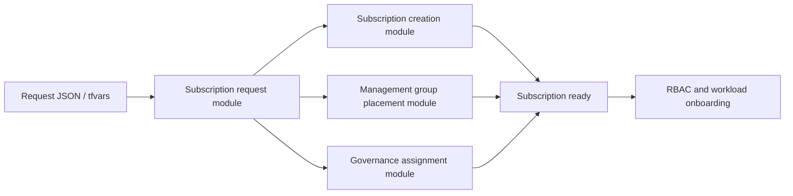

# Subscription vending architecture

The repository models a controlled Azure subscription vending process for platform teams that need a standard workflow for request, approval, placement, governance, and handoff.

## Scope and constraints

- This repository defines the Terraform logic for a controlled subscription vending workflow.
- Actual Azure subscription creation still requires valid billing scope permissions and an organization-level process that is outside the scope of a normal local Terraform validation.
- Management group placement and policy assignment are modeled as Terraform resources but require Azure permission to perform in an active tenant.
- The repo intentionally keeps placeholder values and null defaults in example files so no real tenant, billing, or credential information is included.

## Core flow

1. Capture the subscription request metadata.
2. Validate metadata such as environment, workload, and owner.
3. Optionally create the Azure subscription when a billing scope is supplied.
4. Optionally place the subscription under a management group.
5. Optionally assign a policy definition or initiative to the new subscription.
6. Optionally grant least-privilege RBAC assignments.
7. Publish the request metadata, IDs, and assignment outputs for downstream automation.

## Security notes

- Remote state should use a secure backend such as Azure Storage with encryption at rest and proper RBAC restrictions.
- Secrets, tenant IDs, billing account IDs, and credentials must never be committed to Git.
- The examples intentionally use safe placeholders and `null` defaults.
